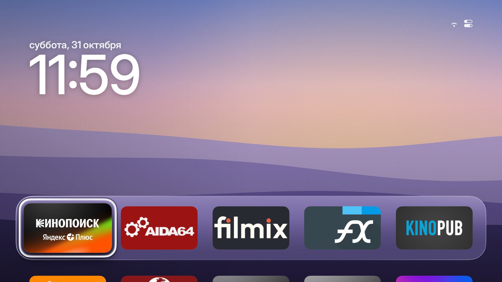
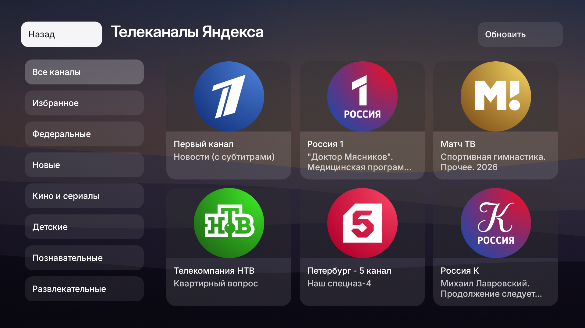
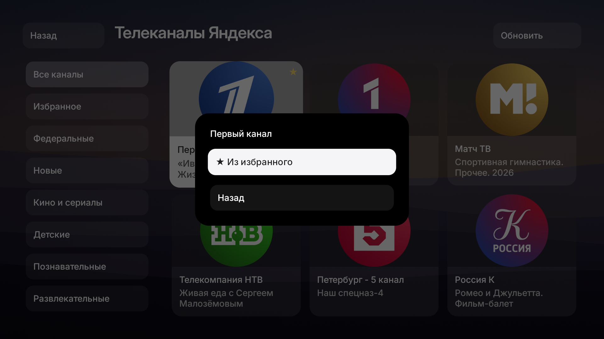

# Aerial UI

**Your TV. Your home screen.**

An open-source Android TV launcher bringing apps, HDMI inputs, channels and settings
into one remote-friendly interface. Aerial UI grew from Aerial Gaia, a fork of
[Aerial](https://github.com/pengchujin/aerial-tv) with GaiaOS/CVTE and
YaOS/MediaTek/Cultraview integrations.

[Published APKs](https://github.com/alexkrass76/aerial-gaia/releases) ·
[Installation and rollback](docs/GAIAOS.md) · [Changelog](CHANGELOG.md) · [Русский](README.md)



## Make the TV yours

- Arrange apps, folders and custom icons; choose wallpapers and personalize from your phone.
- Keep apps and pinned HDMI inputs together, with native vendor playback and Home return.
- Enable the optional content shelf only if you want it.
- Enjoy a consistent dock, focus treatment, animations and settings interface.

## Browse channels in Aerial UI

On compatible YaOS devices, browse a three-column grid with logos, categories,
current program information and local favorites. Press OK to watch; hold OK for
the favorite action. Playback, subscriptions and DRM stay with the stock Yandex
player. Available channels and EPG depend on its provider.



<details>
<summary>Channel context menu</summary>



</details>

## Features

| Feature | What it does |
|---|---|
| Task switcher | Double Home, app tiles, task switching and task dismissal on supported firmware with the optional ADB helper. |
| Video screensavers | Uncluttered video; a direction key reveals time, date, weather and localized captions for 10 seconds. Back exits. |
| Integrated settings | Apps, network, Bluetooth, Android preferences and personalization; additional picture/audio controls on compatible CVTE devices. |
| Direct Boot | A minimal home screen before user storage unlocks, followed by the regular launcher. |
| Phone customization | Local-network settings page, with VPN-aware LAN address selection. |
| Volume overlay | Aerial's vertical indicator and an experimental stock-overlay replacement for the tested CVTE platform. |
| Languages | English, Russian, Ukrainian, Kazakh and Chinese UI. |

AirPlay uses a separate receiver in the tested GaiaOS setup; the launcher APK does
not implement or bundle AirPlay itself.

## Device support

| Tested device | Integration |
|---|---|
| LVG 32LM57, GaiaOS, Android 14 | CVTE/Droidlogic, Direct Boot, Home, native HDMI, additional settings and volume integration. |
| HI VHIX-65U169MSY, YaOS, Android 11 | MediaTek/Cultraview, Home, MediaTek HDMI routing and the Yandex channel catalog. |

Support depends on firmware APIs, not just a brand or chipset. Integrated settings
do not yet replace every stock setting. CVTE controls are not automatically
available on MediaTek. See [architecture and limitations](docs/MULTIVENDOR.md),
[GaiaOS notes](docs/devices/gaiaos-t950s-be30ae.md) and [YaOS notes](docs/devices/yaos-mediatek.md).

## Install and update

Use [published releases](https://github.com/alexkrass76/aerial-gaia/releases) and
the [installation guide](docs/GAIAOS.md), together with the notes for your platform.
Update in place with the same signing key. **Existing Aerial Gaia settings stay:**
the application ID remains `app.orchard.tv.gaia`. Do not uninstall it to rename it.
Updates are manual; upstream installation scripts are not installers for this fork.

This is an app, not firmware. It does not automatically remove system packages.
Disabling the stock launcher is a separate operation requiring boot verification
and a recovery plan.

## Development

Based on upstream Aerial v1.48. Local development history and verification status
live in [CHANGELOG.md](CHANGELOG.md); Releases lists published APKs.

```sh
./gradlew -Pgaia assembleStandardRelease
```

[Build and signing](docs/BUILD.md) · [Platform adapters](docs/MULTIVENDOR.md) ·
[Task bridge](tools/task-bridge/README.md) · [CVTE volume integration](docs/GLOBALUI-REPLACEMENT.md)

## Credits and license

Based on [Aerial](https://github.com/pengchujin/aerial-tv) by **pengchujin**.
The original [MIT license](LICENSE) is retained. Screenshots show actual Aerial UI /
Aerial Gaia development builds on the test YaOS TV. Third-party app and channel
logos belong to their owners; the pictured apps are not bundled with the launcher.
